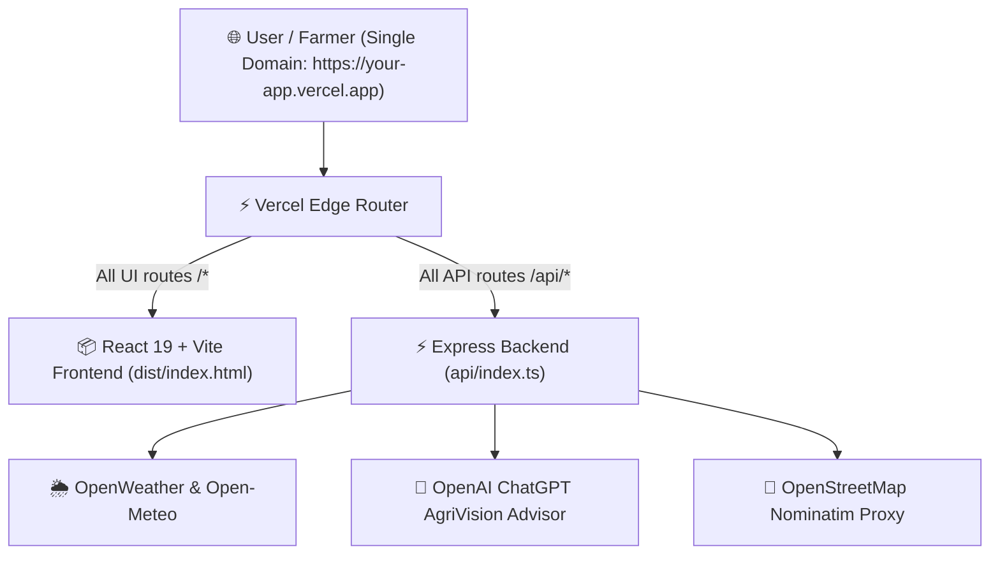

# 🚀 AgriVision — Vercel Single-URL Fullstack Deployment Guide

This guide explains how to deploy the entire **AI Smart Agriculture System** (both Frontend & Backend API) to **Vercel under a single unified URL** with zero CORS issues, instant continuous deployment on every git commit, and automated builds.

---

## 🏗️ Architecture Overview



- **Frontend**: React 19, Tailwind CSS, Google Sans Typography, Motion, Lucide Icons.
- **Backend**: Express API with modular controllers (`/api/auth`, `/api/fertilizer`, `/api/weather`, `/api/chat`, `/api/history`, `/api/location`).
- **Serverless Bridge**: Configured via [`vercel.json`](file:///c:/Users/dharu/Music/AI-Smart-Agriculture-System/vercel.json) and [`api/index.ts`](file:///c:/Users/dharu/Music/AI-Smart-Agriculture-System/api/index.ts).

---

## 🛠️ Step 1: Pre-Configured Files (Already Done!)

The repository has already been configured with the necessary deployment files:

1. **[`vercel.json`](file:///c:/Users/dharu/Music/AI-Smart-Agriculture-System/vercel.json)**:
   ```json
   {
     "version": 2,
     "buildCommand": "npm run build",
     "outputDirectory": "dist",
     "rewrites": [
       { "source": "/api", "destination": "/api/index.ts" },
       { "source": "/api/(.*)", "destination": "/api/index.ts" },
       { "source": "/(.*)", "destination": "/index.html" }
     ]
   }
   ```
2. **[`api/index.ts`](file:///c:/Users/dharu/Music/AI-Smart-Agriculture-System/api/index.ts)**:
   Lazy-loaded Express handler serving all backend endpoints inside Vercel's Node.js runtime.
3. **[`.env.example`](file:///c:/Users/dharu/Music/AI-Smart-Agriculture-System/.env.example)**:
   Template for all required environment variables.

---

## 📦 Step 2: Push Your Code to GitHub (One Commit)

Open PowerShell or Terminal in your project root:

```bash
# 1. Stage all changes and newly organized features
git add .

# 2. Commit the changes
git commit -m "feat: complete AI Smart Agriculture System with Vercel deployment setup"

# 3. Ensure your default branch is named 'main'
git branch -M main

# 4. Push to your GitHub repository
git push -u origin main
```

*(Note: If you are creating a brand new GitHub repository, create it on https://github.com/new and set the remote with `git remote set-url origin https://github.com/<your-username>/<your-repo-name>.git`)*

---

## 🌐 Step 3: Connect to Vercel (One-Click)

1. Go to **[https://vercel.com/new](https://vercel.com/new)** (Log in with your GitHub account).
2. Under **"Import Git Repository"**, find and select **`AI-Smart-Agriculture-System`** (or your repository name) and click **Import**.
3. In the **Configure Project** screen:
   - **Framework Preset**: Select **`Vite`** (or leave as Other / Auto-Detected).
   - **Root Directory**: Leave as **`./`** (default).
   - **Build Command**: `npm run build` (auto-detected from package.json).
   - **Output Directory**: `dist` (auto-detected).
4. Expand the **Environment Variables** section and add the following keys from your `.env`:

   | Key | Value | Description |
   |---|---|---|
   | `OPENAI_API_KEY` | `sk-proj-...` | OpenAI API key for ChatGPT AgriVision & Fertilizer Plan |
   | `VITE_OPENAI_API_KEY` | `sk-proj-...` | Client-side fallback API key |
   | `WEATHER_API_KEY` | `19927003d654bcd63f64e32840eeba91` | OpenWeatherMap API key (optional fallback) |
   | `NODE_ENV` | `production` | Production mode |

5. Click **Deploy**.

---

## ✅ Step 4: Verification & Live URL

Within 60–90 seconds, Vercel will build the Vite assets and deploy your serverless backend.

Your platform will be live at:
```
https://<your-project-name>.vercel.app
```

### Testing the Unified Deployment:
- **Frontend App**: `https://<your-project-name>.vercel.app/`
- **Backend API Health**: `https://<your-project-name>.vercel.app/api/health`
- **Fertilizer Engine**: Accessible directly inside the app tab or via `https://<your-project-name>.vercel.app/api/fertilizer/recommend`
- **Reverse Geolocation Proxy**: `https://<your-project-name>.vercel.app/api/location/reverse?lat=11.2189&lon=78.1674`

---

## 🔄 Automatic Continuous Deployment (CI/CD)

Whenever you make future improvements:
```bash
git add .
git commit -m "update: improvements"
git push
```
Vercel will **automatically detect the push**, build the new changes, and update the live website without any manual intervention!
